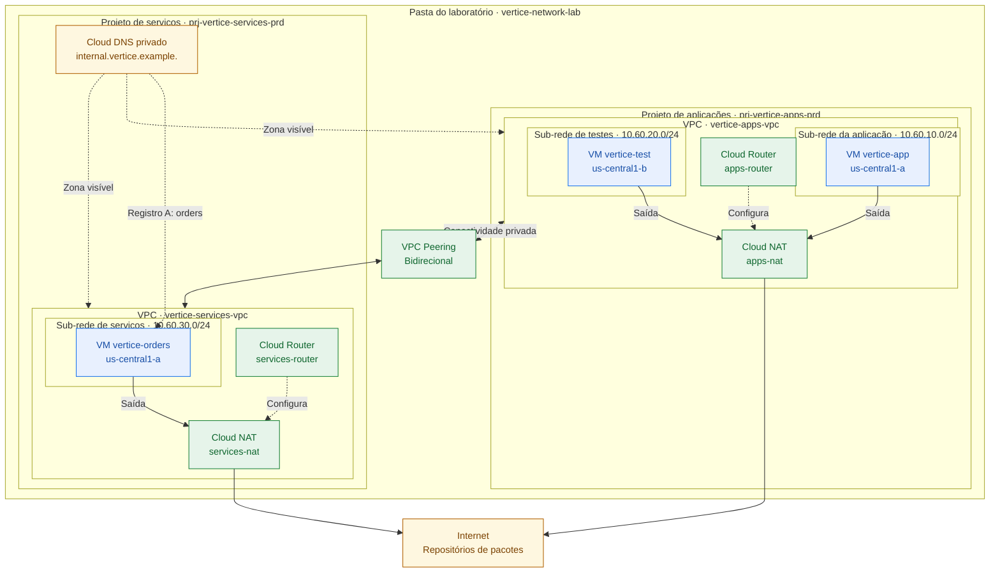
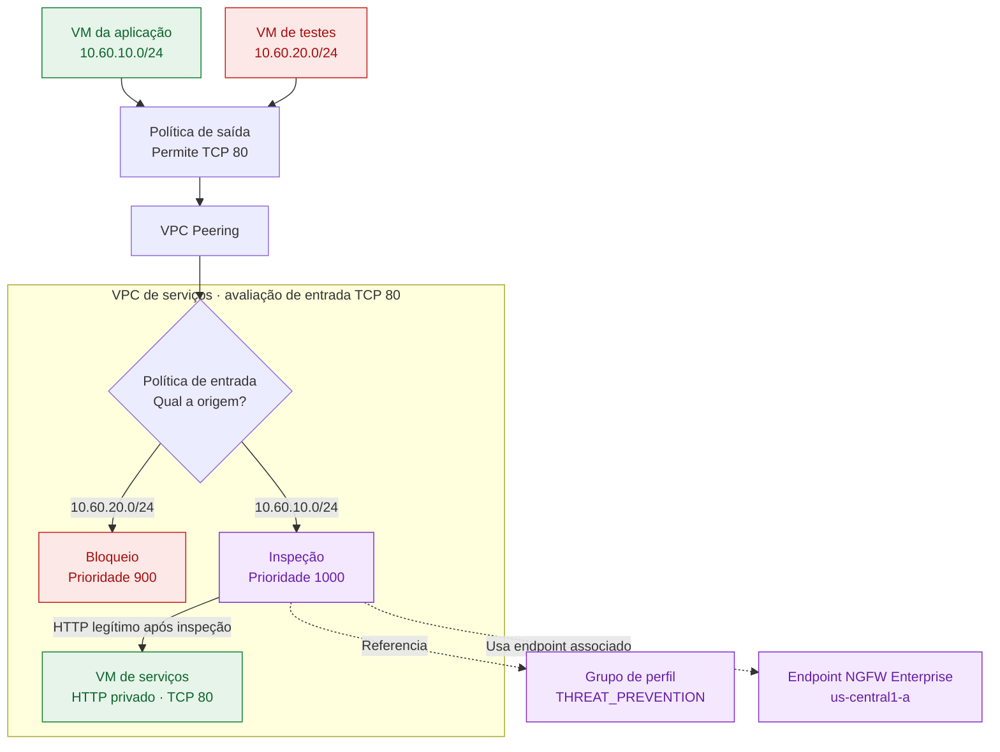

# GCP Secure Network Architecture

Proposta de arquitetura de rede para a empresa fictícia **Vértice Comércio Digital**, com segmentação, conectividade privada, políticas de firewall, inspeção avançada de tráfego com detecção e prevenção de ameaças e diagnóstico baseado em evidências. O objetivo é permitir somente as comunicações necessárias e explicar por que cada fluxo foi permitido ou bloqueado.

## Empresa e cenário de negócio

A Vértice Comércio Digital é uma empresa fictícia de comércio eletrônico. Sua aplicação de atendimento consulta um serviço interno para obter informações sobre pedidos e disponibilidade de estoque. A empresa também mantém máquinas para diagnóstico e testes, que precisam de acessos específicos, mas não devem consultar diretamente esse serviço.

Este estudo de caso possui cenário, requisitos e ambiente próprios, sem dependência de recursos ou de implantações de outros cases. Empresas, cargas de trabalho e dados são fictícios e não derivam de ambientes de empregadores ou clientes.

## Problema identificado

O cenário inicial pressupõe uma rede que cresceu com permissões excessivas e visibilidade insuficiente:

- **Acessos desnecessários:** máquinas com finalidades diferentes conseguem alcançar serviços que não precisam utilizar.
- **Confiança apenas em IP e porta:** permitir HTTP para um serviço não significa que todo o conteúdo dessa comunicação seja seguro.
- **Diagnóstico difícil:** falhas de DNS, conectividade, firewall e inspeção de segurança são difíceis de distinguir sem evidências correlacionadas.

Essas condições são premissas do cenário fictício, não incidentes reais. A necessidade de negócio é disponibilizar pedidos e estoque à aplicação autorizada, sem conceder o mesmo acesso a qualquer máquina da rede e sem confiar apenas na liberação de uma porta.

## Solução proposta

Separar aplicações e serviços internos em redes e projetos próprios, permitindo comunicação privada apenas nos caminhos necessários. Combinar controles de acesso com inspeção do tráfego autorizado e registros suficientes para investigar falhas.

Uma resposta HTTP simples com dados fictícios representa o serviço de pedidos e estoque. As VMs funcionam como origens e destinos dos testes; o foco é a infraestrutura, não o desenvolvimento de uma plataforma de comércio eletrônico.

## Arquitetura proposta

A topologia prevê duas VPCs conectadas por peering e três VMs pequenas, sem IP público:

- **VPC de aplicações:** VM da aplicação e VM de testes em sub-redes distintas.
- **VPC de serviços internos:** VM que representa o serviço de pedidos e estoque.
- **Inspeção de ameaças:** um endpoint do Cloud NGFW Enterprise associado à VPC de serviços, com perfil de segurança e política para inspecionar o HTTP da aplicação.

### Topologia dos recursos

O desenho usa os nomes, CIDRs e zonas fictícios do [arquivo de exemplo](infra/secure_network_lab/terraform.tfvars.example). A pasta é opcional: só será criada quando o avaliador informar uma organização GCP real e as permissões correspondentes; em contas classificadas como **No organization**, os projetos ficam no nível superior da hierarquia. As sub-redes, os roteadores e os NATs usam `us-central1`; as VPCs têm escopo global.



As linhas contínuas representam comunicação ou conectividade; as tracejadas representam configuração e associação. Cada NAT atende somente às sub-redes da própria VPC. Cloud Router configura o NAT e não é uma VM intermediária no caminho dos pacotes. O tráfego entre VPCs usa peering e IPs privados; o NAT atende à saída para a internet.

A zona DNS privada é vinculada explicitamente às duas VPCs, e o registro `orders.internal.vertice.example.` aponta para o IP privado da VM de serviços. O peering não compartilha automaticamente a resolução DNS. Todas as três VMs permanecem sem IP público; as setas para a internet representam conexões iniciadas pelas VMs e suas respostas.

### Controles e caminhos de comunicação

O segundo desenho detalha o comportamento esperado do HTTP privado. As políticas estão associadas às VPCs; o endpoint de inspeção está associado à VPC de serviços em `us-central1-a`.



O fluxo representa decisões lógicas de acesso e inspeção, não equipamentos em sequência física. O endpoint não é um gateway de peering. A regra de bloqueio da VM de testes tem precedência sobre a regra de inspeção; um bloqueio nessa etapa comprova segmentação, mas não comprova IDS/IPS. A validação de ameaças usa a origem autorizada e tráfego de teste inofensivo.

Os recursos de apoio complementam os dois desenhos:

| Recurso ou controle | Relação com a arquitetura |
| --- | --- |
| IAP e OS Login | Administração prevista das três VMs por SSH. As regras permitem TCP 22 da faixa do IAP; habilitação do OS Login e autorizações do operador precisam ser verificadas separadamente. |
| Contas de serviço | Uma identidade compartilhada pela aplicação e pela VM de testes; outra exclusiva da VM de serviços, com permissões de escrita de logs e métricas. |
| Discos de inicialização | Um disco por VM, com imagem e tamanho definidos em `compute_settings`. |
| VPC Flow Logs e logs de firewall | Registram os fluxos amostrados das três sub-redes e as decisões das regras com logging habilitado. Os registros de ameaças complementam a validação da inspeção. |
| Connectivity Tests | Dois testes declarativos relacionam aplicação → serviço e testes → serviço, para comparação com as requisições reais. |
| Network Analyzer | Apoia o diagnóstico de configuração; é uma ferramenta de análise, não um salto no tráfego. |

Os desenhos descrevem a arquitetura proposta e os resultados esperados. A comprovação de conectividade, bloqueio e inspeção depende dos [critérios de validação](#critérios-de-validação).

## Escopo de recursos e controles

| Frente | Recursos e controles propostos | Finalidade |
| --- | --- | --- |
| Endereçamento e segmentação | CIDRs sem sobreposição, duas VPCs e sub-redes por responsabilidade | Separar funções e documentar os limites de comunicação |
| Computação | Três VMs sem IP público: aplicação, testes e serviço interno | Exercitar comunicações com origens e destinos identificáveis |
| Conectividade privada | VPC Peering | Comunicação entre aplicação e serviço por IP privado |
| DNS privado | Zona privada e mecanismo explícito de resolução entre redes | Acesso ao serviço por nome interno |
| Políticas de firewall | Network Firewall Policies, prioridades e controles de entrada/saída | Permitir somente os fluxos necessários |
| Inspeção de ameaças | Cloud NGFW Enterprise com IDS/IPS, endpoint, perfil e grupo de perfil de segurança | Demonstrar detecção e prevenção; requisito obrigatório para conclusão |
| Administração | IAP e OS Login | Administrar VMs sem expor SSH à internet; as autorizações do operador ficam fora desta raiz |
| Saída controlada | Cloud NAT e políticas de saída | Permitir TCP 80/443 e DNS UDP/53; negar os demais protocolos de saída |
| Observabilidade | Logs de firewall, registros de ameaças e VPC Flow Logs amostrados | Correlacionar comportamento e decisões dos controles com custo limitado |
| Diagnóstico | Connectivity Tests e inspeção com Network Analyzer | Investigar caminhos, configurações e causas de falhas |
| IaC e testes | Terraform parametrizado, verificações locais e testes reais nas VMs | Implantação reproduzível, resultados verificáveis e limpeza documentada |

## Estrutura organizacional proposta

Uma pasta dedicada delimita o laboratório, com dois projetos que separam as responsabilidades de aplicações e serviços internos:

```text
Organização GCP
└── Pasta: vertice-network-lab
    ├── Projeto: prj-vertice-apps-prd
    │   └── VPC de aplicações
    │       ├── Sub-rede da aplicação → VM da aplicação
    │       └── Sub-rede de testes → VM de testes
    └── Projeto: prj-vertice-services-prd
        └── VPC de serviços internos
            └── Sub-rede de serviços → VM de pedidos e estoque
```

Os nomes são ilustrativos e parametrizáveis. `prd` representa o papel de produção no cenário fictício, não um ambiente produtivo real. A VM de testes é uma origem controlada de validação, não uma carga de negócio de produção.

| Elemento | Responsabilidade |
| --- | --- |
| Organização GCP | Requisito administrativo para a pasta; não é criada nem gerenciada pelo case |
| Pasta do laboratório | Agrupar exclusivamente os projetos do case e delimitar o escopo administrativo |
| Projeto de aplicações | Hospedar as origens de comunicação e os controles da VPC de aplicações |
| Projeto de serviços internos | Hospedar o serviço protegido e os controles de sua VPC |

As Network Firewall Policies são associadas às respectivas VPCs. A separação por projetos define limites administrativos, mas não substitui as regras que controlam o tráfego. Os recursos e o estado Terraform pertencem exclusivamente a este laboratório.

## Critérios de validação

A aceitação da solução depende da comparação entre comportamento esperado e observado. A matriz de comunicação especifica origem, destino, protocolo, porta, permissão ou bloqueio e necessidade de inspeção. Os itens abaixo são critérios de aceitação, não declarações de testes aprovados.

| Exercício | Resultado esperado | Evidência necessária |
| --- | --- | --- |
| Aplicação resolve o nome privado e consulta o serviço | Resolução DNS e resposta HTTP legítima bem-sucedidas | Saídas dos testes de DNS e HTTP |
| VM de testes tenta acessar diretamente o serviço | Bloqueio pela política de firewall | Falha observada, regra responsável e registro correspondente |
| Origem autorizada gera tráfego de teste inofensivo reconhecido pelo IDS/IPS | Detecção registrada e bloqueio confirmado na etapa de prevenção | Resultado do cliente, perfil aplicado e registro de ameaça correlacionados |
| Regra necessária é alterada de forma controlada | Falha diagnosticada e comunicação restaurada após correção | Análise de conectividade e comparação antes/depois |
| VM tenta saída não autorizada, como TCP 22 ou UDP não permitido | Comunicação bloqueada | Teste negativo e evidência da política responsável |
| Ambiente é desmontado | Recursos do laboratório removidos e resíduos conferidos | Registro de limpeza, incluindo recursos de inspeção e artefatos retidos |

O teste de IDS/IPS deve partir de um caminho permitido pelas regras de acesso; caso contrário, comprovaria apenas um bloqueio de rede. O procedimento deve ser seguro e reproduzível, sem malware real. Provisionar o endpoint, sozinho, não atende ao critério de conclusão.

Análises de configuração não substituem requisições reais nem comprovam sozinhas o funcionamento do IDS/IPS. A avaliação com Network Analyzer não pressupõe que haverá recomendações ou descobertas durante uma sessão curta.

As evidências devem correlacionar origem, destino, horário e controle responsável, sem publicar credenciais ou identificadores privados. O alcance da validação é o conjunto de fluxos e testes documentados, não uma garantia de proteção contra todas as ameaças.

## Implementação Terraform

O código parametrizado do laboratório está em [`infra/secure_network_lab`](infra/secure_network_lab), separado por responsabilidade em arquivos `.tf` com nomes `snake_case`. O [guia da infraestrutura](infra/README.md) descreve as entradas, a ordem dos recursos e os comandos operacionais. O arquivo `terraform.tfvars.example` contém somente valores fictícios; os valores reais do operador devem permanecer em arquivo privado.

Os testes Python estáticos estão em [`tests/`](tests/), com a [matriz de cobertura e resultados esperados](tests/README.md). Eles não substituem a validação real dos fluxos ou do IDS/IPS no GCP.

## Estrutura do case

Os diretórios separam documentação, implementação e validação. O case possui uma única raiz Terraform ativa; não há módulos, ambientes ou estados independentes dentro dela.

```text
gcp-secure-network-architecture/
├── README.md                         # Contexto, arquitetura, escopo e critérios de aceitação
├── infra/
│   ├── README.md                     # Guia operacional do Terraform
│   └── secure_network_lab/           # Raiz Terraform executável
│       ├── terraform.tfvars.example  # Entradas fictícias e parametrizáveis
│       ├── *.tf                      # Recursos separados por responsabilidade
│       └── templates/                # Script de inicialização das VMs de laboratório
├── tests/
│   ├── README.md                     # Cobertura e resultados esperados
│   └── test_*.py                     # Testes estáticos do contrato Terraform
└── docs/
    └── .gitkeep                      # Espaço reservado para documentação pública futura
```

`infra/secure_network_lab` contém toda a lógica de implementação: organização, APIs, projetos, redes, peering, NAT, DNS, políticas de firewall, NGFW, VMs e Connectivity Tests. Os valores do avaliador ficam no `terraform.tfvars.example` e devem ser copiados para um arquivo privado ignorado pelo Git.

`tests/` executa verificações estáticas locais, sem chamar a API do GCP, criar recursos ou executar tráfego. A validação em nuvem continua sendo responsabilidade do operador após uma revisão do plano. O estado, planos, credenciais, arquivos `.tfvars` privados e evidências contendo identificadores reais não fazem parte da estrutura pública do case.

Os pré-requisitos de execução — projeto administrativo/quota já existente, APIs de faturamento e Resource Manager, permissões IAM, conta de faturamento e comportamento com ou sem organização — estão detalhados no [guia operacional do Terraform](infra/README.md).
