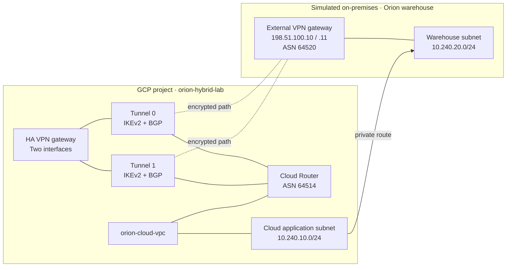

# Hybrid Cloud Networking

## Empresa e cenário de negócio

The fictional company **Orion Field Services** operates a private application in Google Cloud and connects it to a simulated on-premises network used by warehouse systems. The on-premises side is represented only by external peer parameters; no real customer, employer, datacenter, address, or credential is used.

The case demonstrates how an infrastructure engineer plans encrypted hybrid connectivity, route exchange, failure handling, and evidence collection without claiming a physical datacenter deployment.

## Problema identificado

The cloud application needs private access to a warehouse subnet while preserving explicit address boundaries and a predictable failure mode. A single tunnel would create an avoidable availability dependency, and static routes would not demonstrate dynamic route exchange or controlled recovery.

## Solução proposta

Use a dedicated GCP VPC with two regional subnets, a Cloud HA VPN gateway, a Cloud Router, two IKEv2 tunnels, and two BGP sessions to a simulated on-premises external VPN gateway. The cloud side advertises only the application subnet; the peer advertises only the fictional warehouse subnet. Firewall rules allow the documented application protocol and deny unrelated ingress.

The Terraform root owns only the GCP side and the peer contract. The external peer must be configured by the operator or remain a simulation input; this repository does not create or control an on-premises gateway.

## Arquitetura proposta

### Topologia dos recursos (Desenho de arquitetura)

The values below come from [`terraform.tfvars.example`](infra/hybrid_network_lab/terraform.tfvars.example). The public peer addresses use documentation-only ranges.



### Controles e caminhos de comunicação

| Path | Expected control | Evidence |
| --- | --- | --- |
| Cloud application → warehouse subnet | BGP-learned route over either VPN tunnel and TCP 443 firewall allow | Route inventory, tunnel state, and HTTPS probe |
| Warehouse subnet → cloud application | Peer-advertised route and return path over the active BGP session | Peer route inventory and flow record |
| Cloud application → unrelated private range | No advertised route and no firewall allow | Connectivity test failure and firewall log |
| Tunnel 0 interruption | Tunnel 1/BGP session retains reachability | Timestamped failure and recovery measurement |
| Peer secret or ASN mismatch | BGP session remains down; no silent fallback | Router diagnostics and sanitized configuration comparison |

The VPN endpoint is a routing boundary, not an application proxy. Cloud NAT is not part of the private hybrid path. The simulated peer must never be described as a physical datacenter or a second cloud production network.

## Escopo de recursos e controles

| Area | Resources and controls | Purpose |
| --- | --- | --- |
| Addressing | Cloud and peer RFC 1918 ranges with no overlap | Prevent ambiguous routing |
| Encryption | Cloud HA VPN, two IKEv2 tunnels, external peer contract | Provide redundant encrypted paths |
| Routing | Cloud Router, two BGP interfaces and peers | Exchange only declared prefixes |
| Segmentation | Custom VPC, subnet flow logs, ingress firewall rules | Bound workload and evidence paths |
| Availability | Two tunnel interfaces and equal BGP priority | Demonstrate controlled failover |
| Governance | Labels, one Terraform root, local state only | Keep ownership and cleanup explicit |
| Validation | Static contract tests and operator-run connectivity checks | Separate local evidence from cloud evidence |

## Estrutura organizacional proposta

```text
Existing GCP project: <operator-supplied fictional project>
└── orion-cloud-vpc
    ├── application subnet → private application fixture
    └── Cloud HA VPN gateway
        ├── tunnel-0 → simulated on-prem peer interface 0
        └── tunnel-1 → simulated on-prem peer interface 1

External simulated peer
└── warehouse subnet 10.240.20.0/24
```

The GCP project, billing account, peer gateway, and peer credentials remain outside this case's ownership unless explicitly supplied through private variables. The Terraform root does not create an organization, folder, or real on-premises infrastructure.

## Critérios de validação

Local acceptance requires Terraform formatting, validation, and the Python contract tests. Cloud acceptance requires an operator-approved plan and a sanitized evidence set containing:

1. Both VPN tunnels created with IKEv2 and no public workload IP.
2. BGP sessions established with the expected ASNs and link-local peer addresses.
3. Cloud and peer prefixes present only on the expected sides.
4. An HTTPS request succeeding through the private route.
5. An unrelated private destination failing because it has no route or firewall permission.
6. Reachability surviving a controlled single-tunnel failure, with observed recovery time.
7. Tunnel, route, firewall, and cleanup evidence free of credentials and real identifiers.

No apply, tunnel test, or failover result is claimed by this repository. Do not use real customer prefixes, production peer addresses, or shared secrets in published evidence.

## Implementação Terraform

The implementation is in [`infra/hybrid_network_lab`](infra/hybrid_network_lab). It creates the GCP VPC, subnet, HA VPN gateway, external peer contract, Cloud Router, VPN tunnels, BGP sessions, firewall rules, and an optional private HTTP fixture. The external peer must be configured separately or left as a documented simulation input.

The private input file must be copied from `terraform.tfvars.example` into an ignored location. The example contains only documentation addresses and a placeholder shared secret. State, plans, credentials, and real peer outputs are never published.

## Estrutura do case

```text
hybrid-cloud-networking/
├── README.md
├── infra/
│   ├── README.md
│   └── hybrid_network_lab/
│       ├── versions.tf, providers.tf
│       ├── variables.tf, locals.tf
│       ├── network.tf, compute.tf
│       ├── vpn.tf, firewall.tf, outputs.tf
│       └── terraform.tfvars.example
└── tests/
    ├── README.md
    └── test_configuration_contract.py
```

The case has one active Terraform root and does not share state, projects, gateways, or credentials with another case.
