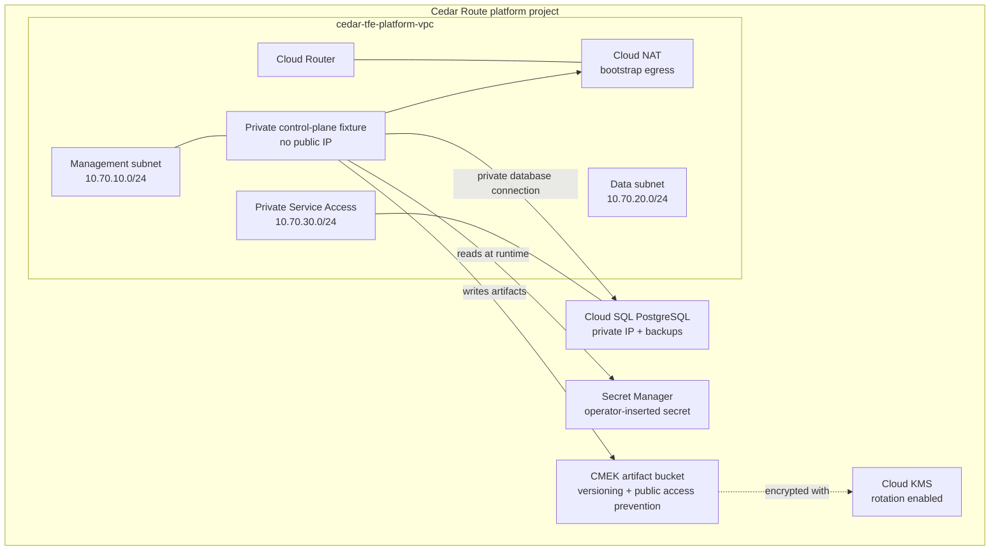

# Terraform Enterprise Infrastructure

## Empresa e cenário de negócio

The fictional company **Cedar Route Logistics** needs a controlled platform for infrastructure delivery. The platform team wants a private Terraform Enterprise-style control plane with isolated data services, encrypted artifact storage, auditable access, and a repeatable teardown path.

This case demonstrates the infrastructure around a Terraform Enterprise deployment. It does not contain a Terraform Enterprise license, product image, vendor credentials, or a claim that the product itself has been deployed.

## Problema identificado

An IaC platform that runs on an unrestricted VM can expose state, administrative endpoints, and database traffic to the public internet. It also becomes difficult to separate application runtime identity from artifact storage, database access, key management, and operator access.

## Solução proposta

Create a dedicated GCP platform VPC with private management and data subnets, Cloud NAT for controlled bootstrap egress, private service access for Cloud SQL, a private PostgreSQL instance with backups, a Secret Manager secret placeholder, a Cloud KMS key, and a versioned CMEK-backed artifact bucket. A private VM represents the control-plane fixture; the real product installation remains an operator-owned follow-up.

## Arquitetura proposta

### Topologia dos recursos (Desenho de arquitetura)



### Controles e caminhos de comunicação

| Path | Control | Expected result |
| --- | --- | --- |
| Operator → fixture SSH | IAP source range, OS Login metadata, operator IAM outside this root | No public SSH exposure |
| Fixture → Cloud SQL | Private service access and database port 5432 | Private-only database path |
| Fixture → artifact bucket | Workload service account and bucket-scoped IAM | No project-wide storage admin role |
| Fixture → package repositories | Cloud NAT and egress logging | Bootstrap has outbound access without public VM IP |
| Internet → fixture | No public address and no internet ingress rule | Connection cannot reach the fixture directly |
| Secret retrieval | Secret exists without a published version; operator inserts value privately | No credential in Git or example variables |

The Cloud SQL private address is not a proxy or public endpoint. KMS protects the bucket's default encryption key; key rotation and IAM must be verified during a live session. The fixture is not a production Terraform Enterprise service.

## Escopo de recursos e controles

| Area | Resources and controls | Purpose |
| --- | --- | --- |
| Network | Custom VPC, private subnets, PSA, Cloud Router, Cloud NAT | Keep control plane and database private |
| Data | Cloud SQL PostgreSQL, private IP, backups, PITR | Demonstrate state database dependencies and recovery controls |
| Secrets | Secret Manager secret without a committed version | Separate secret ownership from infrastructure code |
| Encryption | Cloud KMS key ring and rotating crypto key | Provide a customer-managed encryption control for artifacts |
| Artifacts | Regional GCS bucket, versioning, uniform access, retention and public access prevention | Protect plans and audit exports |
| IAM | Dedicated runtime service account and bucket-scoped writer access | Apply least privilege to the fixture |
| Operations | OS Login metadata, IAP firewall, labels, local state | Keep human access and ownership explicit |
| Validation | Static tests, Terraform validation, plan review and private smoke tests | Distinguish contract evidence from cloud evidence |

## Estrutura organizacional proposta

```text
Existing GCP project: <operator-supplied fictional project>
└── cedar-tfe-platform-vpc
    ├── management subnet → control-plane fixture VM
    └── data subnet / Private Service Access → Cloud SQL PostgreSQL

Project services
├── Secret Manager secret placeholder
├── Cloud KMS key ring and crypto key
└── CMEK-backed artifact bucket
```

The case owns only resources declared in its Terraform root. It does not create an organization, folder, billing account, Terraform Enterprise license, external identity provider, or shared production state bucket.

## Critérios de validação

1. Terraform formatting, validation, and static contract tests pass.
2. The fixture has no public IP, and the database exposes only a private address.
3. Cloud SQL backup and point-in-time recovery settings match the reviewed plan.
4. The bucket rejects public access, uses uniform access, versioning, retention, and the declared CMEK.
5. The runtime service account has only logging, monitoring, and bucket-scoped artifact permissions.
6. Operator SSH uses IAP/OS Login after external operator IAM grants are reviewed.
7. A private database connection and artifact write are observed without publishing secrets.
8. The live lab is destroyed and the remaining bucket, key, secret, database, and NAT resources are independently checked.

No live deployment, product installation, state migration, or recovery measurement is claimed by this repository.

## Implementação Terraform

The implementation is in [`infra/terraform_enterprise_lab`](infra/terraform_enterprise_lab). It creates the platform foundation and a harmless HTTP fixture. It intentionally does not create a Secret Manager secret version or place a database password in the public example.

Copy the example variables into an ignored private file. Review the plan before applying. Keep local state protected, preserve an independent recovery copy, and destroy all billable resources within the approved lab window.

## Estrutura do case

```text
terraform-enterprise-infrastructure/
├── README.md
├── infra/
│   ├── README.md
│   └── terraform_enterprise_lab/
│       ├── versions.tf, providers.tf
│       ├── variables.tf, locals.tf
│       ├── apis.tf, network.tf, nat.tf
│       ├── database.tf, security.tf, artifacts.tf
│       ├── compute.tf, outputs.tf
│       └── terraform.tfvars.example
└── tests/
    ├── README.md
    └── test_configuration_contract.py
```

The root is independent from the landing zone and other cases. Its local state, projects, database, keys, secrets, and buckets must never be reused elsewhere.
