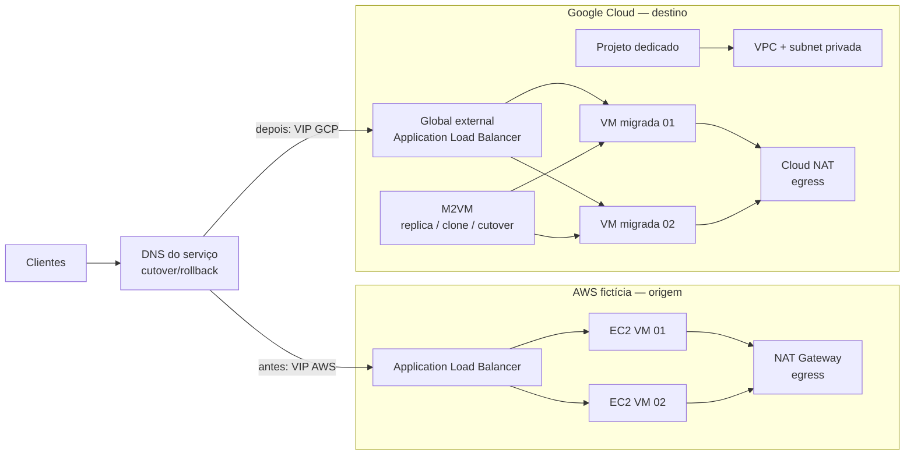

# Case de Migração de VMs entre AWS e Google Cloud

## Empresa e cenário de negócio

A empresa fictícia **Maple Harbor Retail** possui um serviço de pedidos executado em duas VMs na AWS. As VMs são expostas por um Application Load Balancer e usam NAT Gateway para saída controlada à Internet. A empresa decidiu migrar somente essas VMs para o Google Cloud, preservando o padrão operacional: duas VMs atrás de um balanceador e NAT para egress.

Não existe uma conta AWS disponível para este exercício. Por isso, a AWS é descrita como origem fictícia e não é gerenciada por Terraform. O Terraform provisiona apenas o lado do Google Cloud e não cria VMs de destino: as duas VMs de destino devem ser criadas pelo Migrate to Virtual Machines (M2VM).

## Problema identificado

A migração precisa preservar o endpoint da aplicação, limitar a exposição das VMs, controlar o egress e permitir uma virada reversível. Sem uma separação clara entre preparação, replicação, validação, cutover e rollback, seria fácil apontar clientes para um destino ainda não validado ou perder a capacidade de retornar à AWS.

Há também uma limitação prática do exercício: o provider Terraform Google utilizado neste repositório não possui recursos nativos para registrar uma origem AWS ou criar objetos `MigratingVM` do M2VM. Portanto, o Terraform habilita e prepara o projeto GCP e registra um contrato não sensível da origem; o registro efetivo da origem AWS depende de uma conta AWS real e do procedimento do M2VM.

## Solução proposta

1. Usar um projeto GCP dedicado criado manualmente pelo avaliador, com billing, hierarquia e labels definidos antes da execução.
2. Ativar as APIs necessárias, incluindo Compute Engine e Migrate to Virtual Machines.
3. Criar uma VPC, subnet privada, Cloud Router e Cloud NAT para o egress das VMs migradas.
4. Configurar firewall somente para health checks do Load Balancer e administração SSH via IAP.
5. Configurar no Terraform o contrato da origem AWS fictícia: região, filtros de tags e security group lógico para as duas VMs.
6. Criar um Application Load Balancer global externo no GCP, preparado para receber as duas VMs criadas pelo M2VM.
7. Realizar a virada alterando o registro DNS da origem AWS para o VIP do Load Balancer GCP; rollback aponta novamente para o VIP AWS.

O case não provisiona VMs de teste. Antes da migração, o backend GCP ficará vazio e sem backends saudáveis. Após o M2VM criar as duas VMs de destino, seus self-links são informados em um arquivo privado do Terraform e associados a um unmanaged instance group.

## Arquitetura proposta

### Topologia dos recursos (Desenho de arquitetura)



### Controles e caminhos de comunicação

| Caminho | Controle | Resultado esperado |
| --- | --- | --- |
| Cliente → endpoint da aplicação | DNS com TTL curto e mudança revisada | A virada é observável e reversível |
| Internet → GCP Load Balancer | VIP global do Application Load Balancer | Somente o frontend é público |
| Load Balancer → VMs migradas | Health check HTTP e firewall das faixas do Google Front End | Apenas backends saudáveis recebem tráfego |
| Administração → VMs | IAP TCP forwarding, faixa `35.235.240.0/20` e OS Login | SSH sem IP público nas VMs |
| VMs → Internet | Cloud NAT com subnet explicitamente selecionada | Egress sem IP público nas VMs |
| M2VM → origem AWS | API AWS com credenciais temporárias ou IAM dedicado | Descoberta e replicação somente das VMs selecionadas |
| Rollback | DNS retorna ao VIP do ALB AWS | A origem permanece disponível até o aceite final |

O GCP não possui uma regra de firewall que bloqueie o frontend global; a proteção da borda pode evoluir para Cloud Armor. Neste case, a segurança de entrada no backend é feita pelas faixas de health check e pela ausência de IP público nas VMs.

## Escopo de recursos e controles

| Área | Recursos | Escopo |
| --- | --- | --- |
| Projeto | Projeto existente + `google_project_service` | APIs de migração no projeto criado pelo avaliador |
| Rede | VPC, subnet privada, Cloud Router e Cloud NAT | Conectividade e egress do destino |
| Firewall | Health checks e IAP SSH | Entrada mínima nos backends |
| M2VM | `vmmigration.googleapis.com` e contrato Terraform não sensível | Preparação para origem AWS fictícia |
| VMs | Self-links de duas VMs criadas pelo M2VM | Nenhuma VM é provisionada por este root |
| Frontend | Global IP, health check, backend service, URL map, HTTP proxy e forwarding rule | Application Load Balancer global |
| Cutover | Zona DNS e registro A | Alternância AWS ↔ GCP e rollback |

Ficam fora do escopo: recursos AWS, IAM AWS, credenciais AWS, bancos de dados, containers, armazenamento de aplicação, certificados HTTPS de produção e migração de dados não pertencentes aos discos das VMs.

## Estrutura organizacional proposta

```text
Projeto GCP dedicado criado pelo avaliador
└── Ambiente de migração
    ├── APIs: Compute, DNS, IAM, Service Usage e M2VM
    ├── VPC privada
    │   ├── subnet regional
    │   ├── Cloud Router
    │   └── Cloud NAT
    ├── M2VM
    │   ├── origem AWS fictícia
    │   └── duas VMs de destino criadas pelo serviço
    ├── unmanaged instance group
    │   └── VM migrada 01 + VM migrada 02
    └── Global external Application Load Balancer
```

O projeto e seus atributos organizacionais são responsabilidade do avaliador. O estado Terraform deste case deve ser isolado do estado dos demais cases.

## Plano de migração

### Fase 0 — preparação

1. Confirmar que o projeto GCP já existe, possui billing, hierarquia, labels e permissões necessárias.
2. Aplicar o Terraform com `active_backend = "aws"` e sem self-links de destino.
3. Confirmar que as APIs, VPC, subnet, NAT, firewall e VIP do Load Balancer foram criados.
4. Confirmar que nenhum IP público foi atribuído a uma VM GCP; o backend ficará vazio nesta fase.
5. Registrar o VIP do ALB AWS fictício como `fictional_source_ip` apenas para representar o endpoint anterior.

### Fase 1 — origem e replicação M2VM

1. Em uma conta AWS real, criar um IAM dedicado para o M2VM com permissões mínimas de descoberta, snapshots e tags.
2. Registrar a origem AWS na região escolhida no M2VM. A origem deve filtrar somente as duas VMs com a tag `migrate-to-gcp=true` e o security group definido no contrato.
3. Aguardar o estado `ACTIVE` da origem.
4. Criar e acompanhar as duas VMs migradas, mantendo os nomes e portas da aplicação.
5. Fazer um clone de teste de cada VM, validar o serviço, o egress pelo Cloud NAT e os logs.

### Fase 2 — preparação do destino

1. Capturar os self-links das duas VMs GCP criadas pelo M2VM.
2. Preencher `m2vm_settings.target_instance_self_links` no arquivo privado.
3. Aplicar novamente o Terraform para adicionar as duas VMs ao unmanaged instance group.
4. Verificar `2/2` backends saudáveis, resposta HTTP, logs do Load Balancer e egress.
5. Comparar comportamento com a origem AWS antes da virada.

### Fase 3 — cutover

1. Congelar mudanças na aplicação e registrar o horário de início.
2. Confirmar que as duas VMs GCP estão saudáveis e que a origem AWS continua disponível.
3. Alterar `active_backend` de `aws` para `gcp` em uma mudança revisada.
4. Aplicar e validar resolução DNS, HTTP, métricas, logs e erros durante o TTL.
5. Manter a AWS intacta durante a janela de observação.

## Plano de rollback

O rollback prioritário é de tráfego, não de destruição de recursos:

1. Declarar incidente ou falha nos critérios de aceite.
2. Alterar `active_backend` de `gcp` para `aws`.
3. Executar `terraform plan` e `terraform apply` com aprovação.
4. Confirmar que o DNS retorna ao VIP do ALB AWS e que as requisições estão chegando à origem.
5. Preservar logs, horários, resolução DNS e evidências do erro.
6. Não executar `terraform destroy` até que a causa seja entendida e a janela de retenção seja encerrada.

O rollback pode ser limitado por cache DNS, TTL, estado da aplicação e dados alterados durante a janela. A meta do exercício é medir o tempo entre a decisão e a primeira resposta válida da AWS; nenhum RTO ou RPO é declarado sem evidência.

## Critérios de validação

1. Terraform `fmt`, `validate` e testes estáticos passam.
2. O Terraform não cria nem exclui projetos; ele configura somente o projeto informado.
3. As APIs de Compute, DNS, IAM e M2VM estão habilitadas.
4. O GCP possui subnet privada, Cloud NAT e nenhuma VM gerenciada pelo case possui IP público.
5. O Load Balancer global possui exatamente duas VMs migradas no backend após a fase de destino.
6. Os health checks ficam `2/2` saudáveis antes do cutover.
7. O egress das VMs passa pelo Cloud NAT.
8. A mudança para `active_backend = "gcp"` direciona o endpoint ao VIP GCP.
9. A mudança para `active_backend = "aws"` restaura o endpoint AWS.
10. Não há credenciais, chaves, estados Terraform ou dados de clientes no repositório.

## Implementação Terraform

A implementação está em [`infra/workload_migration_lab`](infra/workload_migration_lab). O root configura as APIs, VPC, subnet, Cloud Router, Cloud NAT, firewalls, Load Balancer global e zona DNS no projeto GCP fornecido pelo avaliador. O arquivo `m2vm.tf` mantém o contrato não sensível da origem AWS porque o provider Google não fornece, nesta versão, recursos nativos para o objeto M2VM.

Para usar uma origem real, o operador deve seguir a documentação oficial do [Create an AWS source](https://cloud.google.com/migrate/virtual-machines/docs/5.0/migrate/create-an-aws-source), nunca colocar access keys no Terraform ou no Git, e somente depois informar os self-links das duas VMs migradas.

## Estrutura do case

```text
workload-migration-case/
├── README.md
├── infra/
│   ├── README.md
│   └── workload_migration_lab/
│       ├── versions.tf, providers.tf, variables.tf, locals.tf
│       ├── apis.tf, network.tf, m2vm.tf
│       ├── compute.tf, firewall.tf, load_balancer.tf, dns.tf
│       ├── outputs.tf
│       └── terraform.tfvars.example
└── tests/
    ├── README.md
    └── test_configuration_contract.py
```

Não há arquivos de decisão neste case. O diretório `docs/` permanece reservado para documentação complementar sem dados de ambientes reais.
