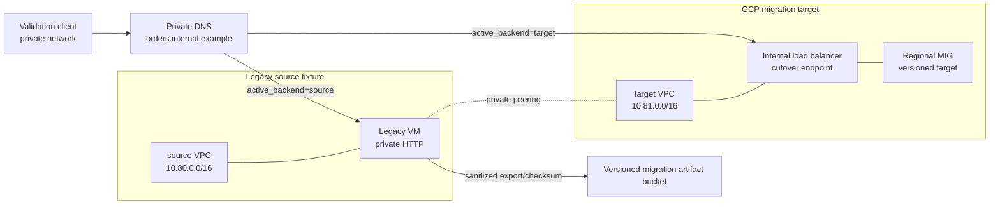

# Workload Migration Case

## Empresa e cenário de negócio

The fictional company **Maple Harbor Retail** is moving a small internal order-tracking workload from a legacy private environment to Google Cloud. The migration team needs a repeatable assessment fixture, a target topology, a controlled cutover, a measurable rollback, and a cleanup procedure.

The source environment is represented by a private GCP fixture labelled `legacy-source`; it is not a real employer, customer, datacenter, or production workload. The target uses managed GCP networking and a regional managed instance group.

## Problema identificado

The legacy service has no clear cutover owner, no isolated target environment, and no preserved application endpoint for rollback. Changing clients directly to a new VM would make it difficult to compare behavior, recover the previous version, or prove that the migration boundary was respected.

## Solução proposta

Build source and target VPCs with explicit peering, keep both service paths private, and place the target behind an internal TCP load balancer. A private DNS record represents the application endpoint. The `active_backend` input selects the source address or target load-balancer address, making cutover and rollback explicit in the reviewed Terraform plan. A versioned staging bucket stores sanitized migration artifacts and checksums.

The root owns only fictional fixtures and target infrastructure. It does not copy customer data, perform an automated database migration, or claim an application cutover has happened.

## Arquitetura proposta

### Topologia dos recursos (Desenho de arquitetura)



### Controles e caminhos de comunicação

| Path | Control | Expected result |
| --- | --- | --- |
| Validation client → active DNS endpoint | Private zone and selected backend input | Only the reviewed backend receives traffic |
| Source VM → target subnet | VPC Peering and narrow migration firewall rule | Data-plane path exists only for migration validation |
| Internet → source/target | No public IPs and no internet ingress | No direct public access |
| Target LB → MIG | Regional health check and backend service | Unhealthy target is removed from service |
| Cutover | Change `active_backend` in a reviewed plan | DNS points to target endpoint |
| Rollback | Revert `active_backend` to `source` | DNS returns to the legacy endpoint |
| Artifact write | Runtime identity and bucket-scoped IAM | Migration evidence is versioned without public access |

DNS selection is a control-plane switch, not instant global propagation. The validation procedure must record TTL, observed resolution, application result, and rollback time.

## Escopo de recursos e controles

| Area | Resources and controls | Purpose |
| --- | --- | --- |
| Assessment fixture | Legacy private VM, labels, source subnet | Represent the bounded source workload |
| Target | Instance template and regional MIG | Provide a repeatable target version |
| Traffic | Internal load balancer and health check | Keep the client endpoint stable during cutover |
| Name resolution | Private Cloud DNS zone and active backend record | Make cutover/rollback explicit |
| Connectivity | VPC Peering and narrow firewall rules | Permit only documented migration traffic |
| Evidence | Versioned private artifact bucket | Preserve checksums and sanitized test outputs |
| IAM | Separate source/target runtime identities | Avoid shared workload permissions |
| Reliability | Health checks, target size, rollback input | Show recovery decision points |
| Validation | Static tests and operator-run smoke/cutover checks | Separate code contract from observed outcome |

## Estrutura organizacional proposta

```text
Existing GCP project: <operator-supplied fictional project>
├── source VPC
│   └── legacy-source subnet → legacy-source VM
├── target VPC
│   └── target subnet → internal load balancer → regional target MIG
└── migration artifact bucket
```

The source and target remain separate network and operational boundaries. Project, billing, organization, identity-provider, and real data ownership remain outside this root. No source state or credentials are shared with other cases.

## Critérios de validação

1. Terraform formatting, validation, and static contract tests pass.
2. Source and target VMs have no public IPs and the target MIG reports healthy backends.
3. The private DNS record resolves to the selected source or target endpoint.
4. The target response is compared with the source response before cutover using synthetic data only.
5. A reviewed `active_backend=target` change produces a successful target smoke test.
6. A reviewed rollback to `active_backend=source` restores the source response within the measured rollback objective.
7. Migration artifacts contain synthetic checksums and no real records, credentials, or identifying data.
8. The target, source fixture, peering, load balancer, DNS, bucket, and retained objects are cleaned up after the exercise.

No migration result, data-loss measurement, or recovery objective achievement is claimed until an operator supplies timestamped evidence. This case is not a substitute for a database-specific migration plan.

## Implementação Terraform

The implementation is in [`infra/workload_migration_lab`](infra/workload_migration_lab). It creates the fictional source fixture, target MIG, internal load balancer, private DNS switch, peering, firewalls, identities, and versioned artifact bucket. The `active_backend` variable is the deliberate cutover/rollback control.

Use a private tfvars file for the project and bucket names. Never add real source data, customer identifiers, secrets, or live migration exports to the repository.

## Estrutura do case

```text
workload-migration-case/
├── README.md
├── infra/
│   ├── README.md
│   └── workload_migration_lab/
│       ├── versions.tf, providers.tf
│       ├── variables.tf, locals.tf
│       ├── apis.tf, network.tf, peering.tf
│       ├── compute.tf, load_balancer.tf
│       ├── dns.tf, artifacts.tf, firewall.tf, outputs.tf
│       └── terraform.tfvars.example
└── tests/
    ├── README.md
    └── test_configuration_contract.py
```

The root contains no decision documents and does not manage resources from the disaster recovery, landing zone, or hybrid networking cases.
